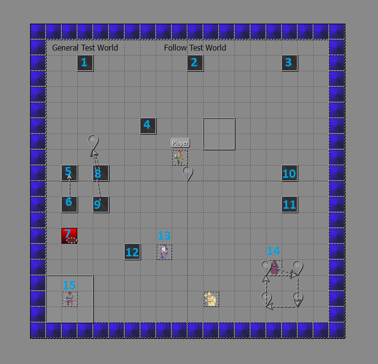
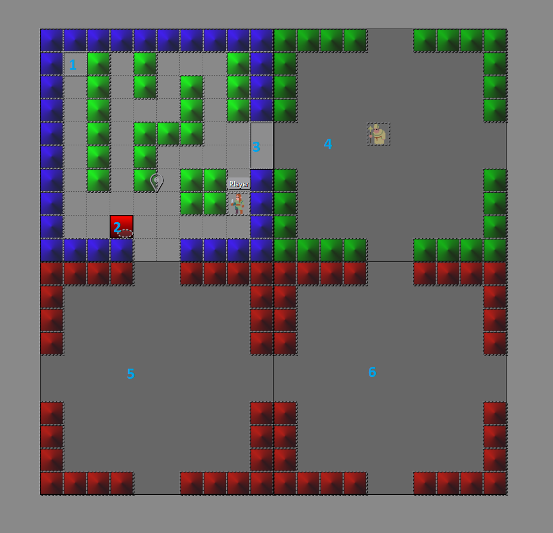
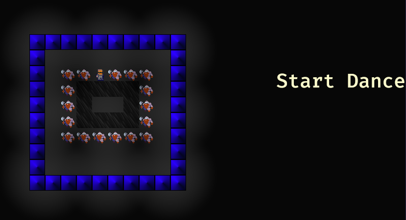

# Spirit Hotel
## Main World

| Number | Description|
|--------|-|
| 1      | Teleports the player to the General Test World.|
| 2      | Teleports the player to the Follow Test World.|
| 3      | Teleports the player to an unfinished world.|
| 4 | Starts a fade in/out effect if the player opens the inventory with "i" and selects and uses the first inventory item. |
| 5 & 6 & 7 | 5 triggers a fade in/out effect if 7 is pushed onto 6. |
| 8 & 9 | if 8 and 9 have been stepped on in any order it opens a dismissable (which can be closed with "esc"). |
| 10 | opens a dismissable when stepped on. |
| 11 | starts a fade in/out effect when stepped on. |
| 12 & 13 | 12 is an interactable trigger (activated with the "e" key when standing on it) that changes the scene to one containing 13. |
| 14 | uses the path following system to move along the specified path, triggering a fade in/out effect when colliding with the player. |
| 15 | starts a dialogue when entering the surrounding trigger and pressing "e" |

## General Test World

| Number        | Description                                                                 |
|---------------|-----------------------------------------------------------------------------|
| 1             | Teleports the player to the Dance World.                                    |
| 2             | Random pushable object                                                      |
| 3 & 4 & 5 & 6 | trigger that switches scenes when walked on which shows and hides 4 5 and 6 |

## Dance World

forces the player to dance (by pressing space) in a circle where they have to reach the same spot they started in
without standing still for too long and without letting the timer run out.
if they fail they are returned to the main menu.